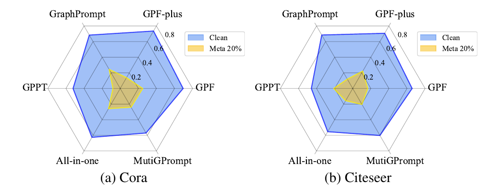
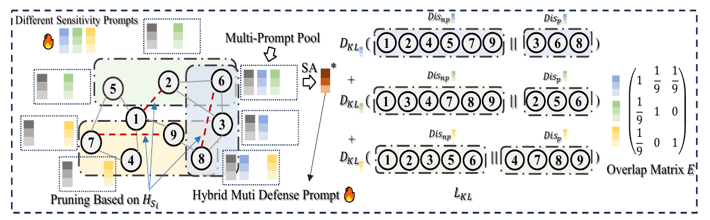
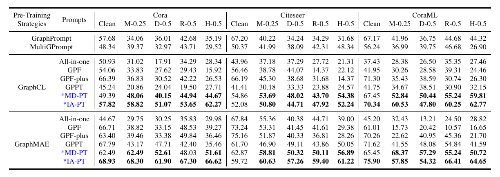
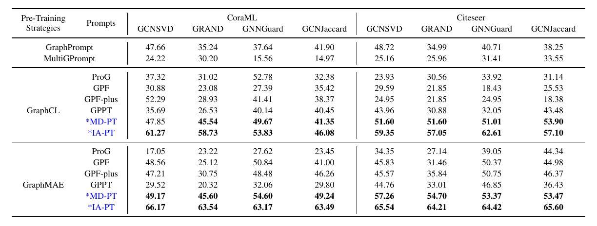
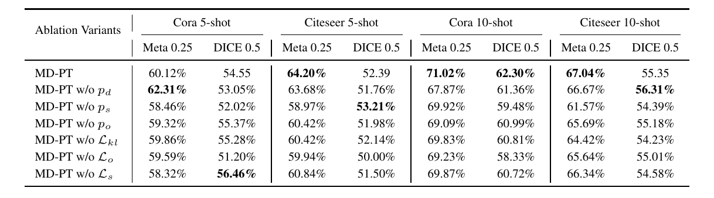

<h1 align="center">
  
  <br>
  
</h1>

<p align="center">
  <strong>Shuhan Song</strong> · <strong>Ping Li</strong> · <strong>Ming Dun</strong> · <strong>Maolei Huang</strong> · <strong>Huawei Cao</strong> · <strong>Xiaochun Ye</strong>
  <br>
  <a href="https://proceedings.iclr.cc/paper_files/paper/2025/hash/473aadf077f8464dbae7e9600d9be6c4-Abstract-Conference.html"></a>
  <a href="https://www.ccf.org.cn/Academic_Evaluation/By_category/"></a>
  <a href="https://portal.core.edu.au/conf-ranks/2273/"></a>
  <br>
  <a href="https://www.python.org/"></a>
  <a href="https://pytorch.org/"></a>
  <a href="https://pytorch-geometric.readthedocs.io/en/stable/"></a>
  <a href="https://lightning.ai/docs/torchmetrics/stable/"></a>
  <br>
  <a href="https://openreview.net/forum?id=yCN4yI6zhH"><strong>🔗 OpenReview</strong></a> ·
  <a href="https://proceedings.iclr.cc/paper_files/paper/2025/file/473aadf077f8464dbae7e9600d9be6c4-Paper-Conference.pdf"><strong>📄 Paper PDF</strong></a> ·
  <a href="#method"><strong>🛡️ Method</strong></a> ·
  <a href="#experiments"><strong>📊 Experiments</strong></a> ·
  <a href="#citation"><strong>📚 BibTeX</strong></a>
</p>

<a name="overview"></a>

## 🧭 Overview

Graph prompt tuning adapts a frozen, pre-trained graph neural network (GNN) to a downstream task using only a small set of trainable prompt parameters. If the graph structure is perturbed during downstream tuning, even a small labeled set on a familiar graph can produce a misleading prompt. The paper shows this effect on Cora and Citeseer, where established prompt methods lose accuracy when tuned on perturbed graphs.

**GPromptShield** defends downstream tuning through two complementary mechanisms. **Direct Handling** learns feature-space prompts for groups of nodes with different signs of structural bias. **Indirect Amplification** expands the supervision signal using predictions from node features. The paper also derives conditions under which a feature-space prompt can recover the frozen model's output on an unperturbed graph.

<p align="center">
  
  <br>
  <em>Figure 3 from the paper · Baseline graph prompts on clean and perturbed graphs.</em>
</p>

<a name="method"></a>

## 🛡️ Method

| Defense | Where it acts | How it works |
| --- | --- | --- |
| **Direct Handling (MD-PT)** | Input features and prompt optimization | The hybrid multi-defense prompt uses node degree, similarity to neighbors, and out-of-distribution signals to identify nodes that may benefit from specialized feature prompts. The tuning objective encourages embedding smoothness and distribution alignment, and uses node-set overlap to constrain the relationships between prompts. |
| **Indirect Amplification (IA-PT)** | Supervision during prompt tuning | A feature-only MLP trained on the few labeled examples produces pseudo-labels. The most confident predictions per class expand the supervision available to tune the prompt while the graph encoder stays frozen. |

<p align="center">
  
  <br>
  <em>Figure 4 from the paper · Robust prompt optimization for the hybrid multi-defense prompt.</em>
</p>

<a name="experiments"></a>

## 📊 Experiments

The main evaluation covers **5-shot and 10-shot node classification** on **Cora, Citeseer, and Cora-ML**, with clean, non-adaptive, and adaptive evaluation settings. It tests both **GraphCL** and **GraphMAE** pre-training and compares against established graph prompting baselines. The appendix includes additional node classification results and exploratory results on link prediction and graph classification.

### Non-adaptive evaluation

With **GraphMAE** in the 5-shot Cora setting under the **M-0.25** condition, IA-PT achieves **68.30%** accuracy. GPPT is the strongest baseline in that setting at **43.17%**, a gap of **25.13 percentage points**.

[](./docs/gpromptshield/table-01-non-adaptive.png)

### Adaptive evaluation

**IA-PT** has the highest reported accuracy in all eight dataset and defense combinations in Table 2 for both GraphCL and GraphMAE.

[](./docs/gpromptshield/table-02-adaptive.png)

### Table 3 · MD-PT ablation study

The ablation study measures the effects of removing individual feature prompts and training constraints on Cora and Citeseer under 5-shot and 10-shot supervision.

[](./docs/gpromptshield/table-03-ablation.png)

<a name="repository-guide"></a>

## 🗂️ Repository guide

| Path | Contents |
| --- | --- |
| [`MyPretrain.py`](./MyPretrain.py) | Entry point for graph encoder pre-training. |
| [`MyTask.py`](./MyTask.py) | Entry point for downstream prompting and evaluation. |
| [`prompt_graph/prompt/`](./prompt_graph/prompt) | GPromptShield and baseline prompt implementations. |
| [`prompt_graph/pretrain/`](./prompt_graph/pretrain) | GraphCL, GraphMAE, and other pre-training methods. |
| [`prompt_graph/evaluation/`](./prompt_graph/evaluation) | Downstream evaluation routines. |

<a name="citation"></a>

## 📚 Citation

```bibtex
@inproceedings{song2025gpromptshield,
  title     = {{GPromptShield}: Elevating Resilience in Graph Prompt Tuning Against Adversarial Attacks},
  author    = {Shuhan Song and Ping Li and Ming Dun and Maolei Huang and Huawei Cao and Xiaochun Ye},
  booktitle = {International Conference on Learning Representations},
  year      = {2025},
  url       = {https://openreview.net/forum?id=yCN4yI6zhH}
}
```
